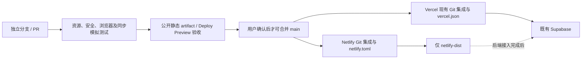

# Netlify 静态镜像与双平台部署审查

基线：main `9a51968`（PR #99），独立分支 `fix/netlify-mirror-resource-audit`。本次仅修改构建、Netlify 配置、测试及本文档；不修改 Vercel 配置、业务 UI、登录逻辑、数据库或用户数据。未经验收不合并、不执行生产部署。

## 结论和交付边界

1. 白屏的确定代码原因：`index.html` 的有序启动列表包含 `lib/link-recovery.js`，但静态构建白名单漏掉此文件；`shared-sync/bootstrap.mjs` 在该脚本加载失败后停止后续模块并保持启动遮罩。
2. 已检查并复用现有 `fix/netlify-missing-link-asset-20261031` 的 `2aa0ffb`，不是重新实现链接恢复。原 `feat/netlify-static-mirror-20261031` 已通过 #99 进入 main。
3. 新增资源审计、显式根文件清单、PDF.js 构建与安全发布配置。Netlify 仅发布 `netlify-dist/`。构建遇到本地依赖缺失会失败，不能以绿灯掩盖下一次白屏。
4. **本阶段可运行的是静态工作台；不是已接通账号、飞书和 AI 的完整后端镜像。** `/api/*` 明确返回404及 `mirror_backend_unavailable`，没有代理到生产或执行收费调用。原界面会使用已有的未配置/本地模式。
5. 两站共用 Supabase 技术可行，现有四类文档和任务同步不需新库；但是浏览器本地数据与登录会话不会跨域共享，必须分别登录并显式启用同一账号云工作台。
6. 未拿到 Netlify 管理权限或配置绑定，不能宣称已修改站点构建设置、启用 Git 集成或修复现网。可供验收的构建产物位于 CI 的 `netlify-static-mirror` artifact；现有站点和 Deploy Preview 的真实状态以 CI 只读探测与平台记录为准。

## 变更清单

- 复用三项浏览器 `lib/` 白名单，补上 `link-recovery.js`；其余 `lib/` 仍不公开。
- 根 HTML/CSS/JS/MJS/manifest 显式清单 `scripts/netlify-public-root.json`，新增根 `server.js` 不会被随扩展名自动发布。
- 允许当前页面实际使用的 `mobile/update-notes.json` 和已有发布 APK/校验值/插件 ZIP；不复制任意 JSON 或服务端元数据。
- 同时执行现有 `build-reading-assets.py`：固定 PDF.js 4.10.38、校验 SHA256，再复制本地 PDF 核心、worker 和许可证。保持 Vercel 现有构建不变。
- `scripts/audit-netlify-assets.py` 检查 HTML、启动列表、模块路径、CSS 图片/字体与 service worker 的本地字面依赖，输出无密钥的 `mirror-assets.json`。动态计算和供应商内部依赖由浏览器请求补验；不把外部 URL 清单误称为外网连通测试。
- 无全站 SPA fallback，缺失 JS 返回404，不返回200的 HTML。API 返回明确的静态不可用响应。
- CI 验证隔离目录、敏感文件/服务端不公开、页面启动、外部 CDN 故障、移动端、数据保留和双来源同步；上传公开产物供预览验收。工作流不包含部署、合并或数据库写入命令。

## GitHub → 双平台机制

Netlify 管理员后续在现有站点 **Build & deploy** 核对：仓库为本仓库、生产分支 main、base 为根目录、命令从 `netlify.toml` 读取、publish 为 `netlify-dist`。验证 PR Preview 后再授权合并；不要拖放整个仓库。若网站目前为手动部署，需要管理员先关联 Git，仓库文件本身不能替代平台绑定。

Vercel 保留现有平台绑定与 `vercel.json`，本次不修改。两平台从同一个已批准 main SHA 构建；不是分别维护两套源码。部署故障时保留各自最近可用版本，不回滚数据库。Netlify 不发布 Android OTA `mobile/updates`；原 App 的更新来源继续是 Vercel。

`netlify.toml` 提供无相关代码变化时的 build ignore。建议 Netlify 仅 main 自动生产构建；分支只保留本次 PR Preview，合并前集中跑一轮目标测试。最终发布前记录两平台 SHA 与本地资源 manifest，核对具体静态文件而非只看首页 HTTP200。

## 资源与 Markdown 编辑器

本地审计：162个公开文件、239处引用、缺失0（包含字体/图片路径规则）。所有已发布应用源码和账号同步文件保持原字节，非打包改写。

- PDF.js：原 main 构建期间生成；Netlify 原命令若仅复制静态文件会漏掉 PDF 引擎。现配置复用现有可信构建。
- 阅读编辑器：`reading-v2.js` 使用 jsDelivr 的 Vditor 3.10.4，`index.css/index.min.js` 是外部 CDN 拼接路径，不是根目录漏文件。
- 日记编辑器：`daily-modules.js` 依赖未固定版本的 Vditor CDN。测试模拟 CDN 不可达，确认工作台仍可启动；不代表富文本编辑器所有增强能力可用。
- CDN 是中国网络可用性的剩余风险。后续如需完整离线编辑器，单独固定相同版本与完整 `dist` 资源（主题、图标、Lute/渲染依赖、字体），校验许可证和摘要后同源托管并单独回归。不能只复制两个 JS/CSS 就称迁移完成。本轮保持原 UI 和加载逻辑。

## 数据盘点与同步可行性

|模块|本机存储|云端情况（以 main 代码为依据）|跨域/跨设备要求|
|---|---|---|---|
|任务、项目、每日复盘|localStorage；账号 journal、待上传批次、冲突记录|`lambert_items` / mutation RPC，版本与用户隔离|同一账号、显式启用云工作台，处理冲突|
|阅读工作区、独立写作笔记、公共/个人书签|账号 localStorage；四项 `DOCUMENT_KEYS`|documents 记录同步|已有迁移需已在真实项目生效；不同设备各自登录|
|PDF 书架|账号 IndexedDB 二进制缓存|`shared-sync/book-store.mjs` 支持 `lambert_books` + 私有 `lambert-books`，手动/显式上传|同一账号，真实 bucket/RLS/容量已配置；不能把“仅本机”当云文件|
|旧英语音频、App 音频/字幕、播放进度与逐条备注|`english-audio-store.mjs`、`shared-sync/audio-store.mjs` 的账号 IndexedDB|当前 main 以本机库为主；不因镜像新增音频云同步|原文件/字幕需保留并重新导入；不沿用其他未合并分支的云能力结论|
|旧视频课程、音标、学习历史|账号 localStorage；媒体运行期 Blob URL|不在当前四项 documents 中|不能自动跨设备；媒体需重新选择|
|旧日记/旧阅读数据|`daily_writing_v1/v2`、`daily_reading_v1` 等 localStorage|不在 `DOCUMENT_KEYS`；飞书归档是外部快照|不能把归档当作 Supabase 双向同步|
|物流知识、画 Master 文件/流程|账号 localStorage + `lambert_master_files_v2` IndexedDB|当前不在 documents 白名单|需另立迁移方案，不在本轮自动上传|
|偏好、布局、登录态、AI 会话|各站点 localStorage/运行期状态|登录认证共用项目，不共用浏览器会话字节|两个域分别登录；绝不能跨站复制 JWT 到 URL|

依据：`shared-sync/document-keys.mjs`、`journal.mjs`、`engine.mjs`、`private-storage.js`、`book-store.mjs`、`audio-store.mjs`、`master-library-v2.js` 及 `supabase/migrations`。仓库有迁移文件不等于真实数据库已应用，本轮未查询或变更生产数据库。

原 Mac 有数据、Netlify/手机没有的原因：localStorage、IndexedDB 和站点 Cookie 都按 origin（协议、主机、端口）隔离。Mac 的 Vercel 本地数据不会因同一 GitHub 仓库而出现在 Netlify，也不会因登录本身自动上传。云端记录只在主动启用云工作台、上传成功后才可共享；pending/仅本机内容不会凭空出现。账号隔离前缀也不改变浏览器的跨域隔离。

接入条件：

1. 复用现有 Supabase URL 和 **公开 publishable key**；不使用 service-role/secret key。项目 RLS 和用户 UUID 继续由现有逻辑约束，不新建库。
2. Netlify 未来提供自己的 `/api/account-config`（只输出现有 `publicConfig` 校验通过的公开配置），`LAMBERT_PUBLIC_SITE_URL` 指向 Netlify 的固定域名。Vercel 的同名变量保留原值。
3. Supabase Auth 保留 Vercel Site URL，在 Additional Redirect URLs 精确增加 Netlify `/account.html`；不要给任意 PR 域开放通配登录回调。否则找回密码/验证可能落回 Vercel，Netlify 上看不到那份会话。
4. Storage/CORS 如启用站点来源限制，添加两个固定来源；数据库 RLS 不放宽。浏览器直接用本人 JWT 访问既有 REST/Storage，不需要通过 Vercel 代理数据库。
5. 验证两真实账号互不可见，再测同账号 Mac→手机和手机→Mac、离线重连、并发修改、退出切换与过期会话。mock 双来源测试不能冒称真实托管联调。

## 原 Mac 无损接入步骤

在原 Mac 保持原 Vercel 浏览器资料与现有安装，不清缓存、不卸载：先用账户中的完整备份下载 JSON，保留原媒体/PDF/字幕/画图源文件；额外导出不在工作区备份内的模块。`shared-sync/backup.mjs` 的工作区备份不能保证包含所有 IndexedDB 二进制。

核对备份副本和条数后，原 Mac 使用原账号执行“检查并导入本机数据”，先看预览和冲突，不自动覆盖云端。同一账号在第二设备启用云工作台，确认任务、项目、复盘、四项文档；PDF 仅检查已确认上传的书籍。音频、旧历史和 Master 文件保持本机原副本，另作模块级迁移。本轮不执行这些导入操作。

## 飞书与 AI API 迁移清单

|现有端点|Netlify 迁移工作|必须保留的约束|
|---|---|---|
|`/api/account-config`|GET 公开配置 Function，复用 `publicConfig`|拒绝 secret/JWT key；no-store；站点回调分环境|
|`/api/feishu-review`|Node Function 适配 req/res、JSON、Bearer、OPTIONS；复用 handler|云端读取本人复盘、允许邮箱、快照幂等/pending 防重复；不信任客户端文档正文|
|`/api/feishu-daily`|适配正文大小、图片 FormData、超时与响应|现有端点授权需单独审查；不因搬平台扩大公开写权限；不自动重试造成重复文档|
|`/api/feishu-targets`|GET/PUT、JSON、Origin/Host 与密码校验适配|配置密码和 Redis 只放 Functions 环境；禁止前端获取 Redis token|
|`/api/feishu-health`|Node Function 健康检查|只返回脱敏状态，不返回飞书 token/secret|
|`/api/ai-analyze`|Node crypto、raw request/response、cookie、来源校验、服务超时与 Redis|统一 Redis 配额/并发锁，两域共用真实预算；签名会话不跨域偷用；模型与 token 上限保持|
|`/api/link-metadata`|受限服务端抓取 Function|同源校验、SSRF/DNS/重定向保护、抓取大小与超时|

Vercel 采用 Node req/res；Netlify 新式 Functions 使用 Request→Response，旧式 handler 则 event→`{statusCode,headers,body}`。现有文件混有 CommonJS/ESM，不能只复制 `api/` 并重命名。应先抽/复用业务 handler，再用 esbuild 验证包装；逐项测试405、401、403、429、OPTIONS、大小限制和超时。保留现有幂等键，不能在两平台各自创建独立无共享预算的限流计数。

禁止把 `/api/*` 直接广泛代理到生产：现有 AI、链接识别和飞书设置使用 Origin/Host 检查，简单跨域调用会403，伪造转发头绕过校验会削弱安全。Netlify 使用自己的 Functions/同源路由，服务端秘密仅配置到 Functions 环境。第一阶段不设置这些秘密，也不打开收费 API。

## 免费额度、频率和风险

没有读取三家平台账号账单，当前环境也未成功访问官方定价页。因此不虚报本账号套餐、剩余额度或2026-10-31的具体价格。Netlify 旧套餐与 credits 套餐可能不同，按当前站点 Billing 为准；不要沿用旧版“无限免费部署”说法。

- 官方核对入口：[Netlify pricing](https://www.netlify.com/pricing/)、[Vercel Hobby](https://vercel.com/docs/plans/hobby)、[Supabase pricing](https://supabase.com/pricing)。发布前记录当前账户构建/部署 credits、流量/请求、Functions、数据库/Storage/egress 和暂停/超额行为，不自动升级付费。
- 建议默认每天最多一次人工验收后的合并发布，紧急修复另记；文档/报告变更不触发镜像构建，取消旧分支 CI，主分支稳定后关闭无用 branch deploys。此为建议，未修改平台设置。
- APK、ZIP、PDF 等大文件下载会占流量；当前镜像总产物包含已有下载入口。先观察真实访问量，不另买对象存储，不自动迁移下载域名。
- 双站共用 Supabase 会增加 REST/Storage 访问与出站流量，但不会复制数据库容量；共用 AI Redis 预算才可防止费用翻倍。API 继续默认关闭直到独立验收。
- Netlify 并不保证中国大陆所有网络可达；域名、CDN、Supabase、编辑器 CDN 都需分别在 Mac/手机实际网络验证。

|等级|风险/依据|本轮措施或验收条件|
|---|---|---|
|P0|漏启动资源导致遮罩/白屏：index 启动列表与 build 白名单不一致|复用恢复脚本修复，构建缺依赖即失败，浏览器验证|
|P0|把仓库根当发布目录会公开服务器代码/工具|专用目录、根文件白名单、lib 精确白名单、敏感/服务端隔离测试|
|P0|跨域误当共享本机数据导致错误清空/覆盖|不加数据迁移、不清理存储；显式备份/云端选择方案|
|P1|静态能开但 API 不可用|API 明确404；未声称飞书/AI/登录已迁移|
|P1|CDN 与国内网络不稳定|离线 CDN 故障启动测试；编辑器同源化留待独立确认|
|P1|跨域登录回调和 RLS 配置未真实联调|精确来源配置及真实双账号验收后才启用|
|P2|新根资源未入清单/动态资源漏报|CI 路径覆盖和资源审计；新增业务模块须更新 manifest 和对应浏览器用例|

## 验证记录

- 本地构建：162公开文件，239处字面本地依赖，缺失0；4项 Python 目标测试通过。
- Chromium：工作台/导航和移动端启动；CDN 不可达仍可启动；缺失 JS 和服务器文件404；测试任务原有字段/未知字段与 localStorage 标记保留。原 main 会补齐任务默认字段，测试检查原内容保留，不把默认字段补齐当作镜像数据丢失。
- 双来源：通过扩展原账号回归的 `TEST_DESKTOP_ORIGIN`，用两个端口模拟不同网站，共用 mock Supabase；最终结果由 CI 注释记录。未在生产录入任何测试用户数据。
- GitHub CI 产物、PR 创建结果和部署预览元数据见 `Netlify mirror validation` 工作流；不以本地测试代替真实 Netlify 域名测试。本地对 Netlify/定价站点的请求受当前网络限制，线上状态尚待只读探测。
- 本轮不调用外部 AI 模型，不新增模型成本；构建与业务改动由 Codex 完成。未修改 Vercel、Android、业务 UI 或数据库。

## 首轮云端验证及外部阻塞

GitHub Actions [41180185537](https://github.com/liuchengyin/lambert-ai-os-dashboard/actions/runs/41180185537) 在提交 `9bcab47` 通过：公开构建、4项 Python 检查、浏览器和两个 origin 共用 mock 后端回归、18项同步与安全单元检查。生成约12.5 MB的 `netlify-static-mirror` artifact（含原有安装包）。后续提交补测首次构建的 ignore 判定、IndexedDB 保留和缺失恢复脚本的故障复现。

PR 自动创建被 GitHub 明确拒绝：`GitHub Actions is not permitted to create or approve pull requests`。尚无实际 PR 编号；[从已推送分支创建 PR](https://github.com/liuchengyin/lambert-ai-os-dashboard/compare/main...fix/netlify-mirror-resource-audit?expand=1)。管理员可在 Settings → Actions → General → Workflow permissions 核对该权限，或直接从比较页建立审查 PR；不需要向聊天提供 Token。

对 `https://lambert-ai-os-cn-test.netlify.app/lib/link-recovery.js` 的云端只读检查返回 HTTP401，现网可能存在访问保护，具体来源需由站点管理员确认。没有绕过或关闭保护，也没有把401误报为缺文件404。现网白屏修复是否已经生效、实际国内网络访问、完整 Markdown CDN 联通均尚未验证。代码及静态产物可审查，但不能宣称 Netlify 已生产发布。

同提交存在 Vercel 非生产 Preview：`https://lambert-ai-os-dashboard-hzbcdodoy-liuchengyin8030-8582.vercel.app`。它是 Vercel 的分支预览，不是 Netlify 修复上线的证据；原正式版未变。
