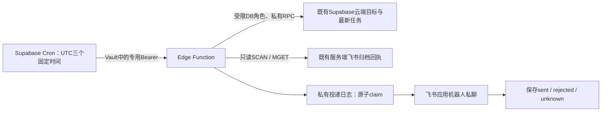

# 飞书定时提醒 V1：实现与验收说明

基线 main `62ad322`，分支 `feat/web-feishu-reminders-v1`。当前是**未启用的实现稿**：未应用线上迁移、未部署 Edge Function、未安装 Cron、未发送真实消息。按需求流程，必须先完成单条私聊送达验收，才创建 PR；不会跳过这一步把“模拟测试成功”说成上线成功。

## 实际业务口径

源码依据：`review-v6.js:80` 的 `taskIds` 与 `mobile/app.js` 的每日目标，`lib/feishu-review-handler.js` 的服务端归档回执。

- 当前任务并非单独的 `tasks` 表，而是 `public.lambert_items` 的 `kind='tasks'`；复盘是同表 `kind='reviews'`、`item_id=北京日期`。`daily_reviews_v2` 是客户端工作区的视图。
- 只取当天复盘的 `taskIds`，查询指定用户对应任务的最新行，不读过期 `taskSnapshots`。不补入全部待办、未来任务或历史逾期。去除重复 ID、云端 tombstone、`deletedAt`、`archived`、归档状态；缺失关联任务不计入。只有状态严格等于“已完成”才计完成。
- 没有目标或全部完成，不发任务消息。21:30 即使没有任务，也独立判断复盘提交。
- `review-v6.js` 的本地“归档当天”仅切换 `archived`，不代表提交；非空内容、`updatedAt`、客户端 `feishuUrl` 都不能证明服务端提交。
- 既有 `/api/feishu-review` 在 Redis 写入 `feishu:review:v1:<user>:<date>:<fingerprint>`：只有 `state='done'`、有效飞书 URL、成功时间才视作真实提交。复用该服务端回执，不改现有任务、复盘、归档接口或客户端数据结构。
- V1 定义“当天已有一次成功提交”为已提交，提交后再编辑草稿不会自动恢复为未提交。`pending`/格式异常/读取失败/未完成扫描属于**未知**，不当作未提交；21:30 本轮不发基于未知数据的消息。

## 架构与权限



优先 Supabase Cron + Edge，没有 Vercel/Netlify 各自再建定时任务，避免双平台重复执行。网页、Mac、手机是否开着无关；**尚未同步上云的本机修改不可能被云任务看到**。

不用 Supabase `service_role` 或数据库管理员凭据作运行身份。新增 `lambert_reminder_worker`，默认 NOLOGIN、NOINHERIT、NOBYPASSRLS；管理员稍后安全设置独立密码。只授予私有 schema usage 和限定函数 execute，不授予业务表或私有表直接 SELECT/UPDATE。RPC 只读取明确启用且真实存在的账号，返回任务标题/状态等最小字段，不返回任务备注、其他用户内容或复盘正文。

`reminder_private.recipients` 只在数据库后台保存 Supabase 用户 UUID 与飞书 open_id，默认 disabled；V1 只允许一个启用绑定。open_id 唯一，claim 再校验当前接收人未变化，不能让客户端传一个接收人绕过绑定。

Edge 关闭平台用户 JWT 验证是为了 Vault→服务间调用；**不是公开执行**：所有 POST 先验证独立至少32字符随机 Bearer，摘要按固定长度比较；普通用户 JWT、浏览器无凭据请求均不能运行。dry-run 也需要此凭据。无 CORS 浏览器写入口。方法/请求体/模式/开关先校验，不通过不连数据库。错误不反射凭据或业务内容。

## 去重与安全重试

`deliveries` 主键：用户 + 北京日期 + 时间点 + 类型。任务、复盘分别建行，11:45和19:00允许各发一次。单事务 insert/conflict/row lock 只有一个执行者取得 claim；消息 UUID 持久保存，重试不换 UUID。不是内存去重，也不依赖飞书 UUID 去重时长保证正确性。

状态：

|状态|含义|后续行为|
|---|---|---|
|sending|已持久占位，可能尚未请求或进程已中断|不自动抢占/过期重发；人工核对|
|sent|飞书明确返回成功与 message_id，且日志写成功|永久去重该日期/时间/类型|
|rejected|明确鉴权前失败，或消息 API 明确业务拒绝|修复原因后可显式安全重试；再次读最新目标和状态|
|unknown|发送超时、网络断开、5xx、缺失成功回执|禁止自动/普通重试，先查飞书送达记录|

如果消息已发但日志落库失败，原 sending claim 保留，后续同一时间点不会再发。不能用“租约超时”自动重发未知结果。飞书 UUID 原样传入，可作为额外保障，但不以此放宽未知重试。

查询失败先写脱敏检查日志，再停止该次收件人决策；数据库本身不可用时请求返回失败、不发送。私有 `checks` 保存结果、日期/时间和数量；不记录标题、消息正文、访问令牌或 open_id。`deliveries` 保存投递状态、尝试次数、消息 UUID、provider code/message_id，不存真实消息正文。

## 当前环境预检：已核实与未核实

已核实：仓库使用 Supabase 和服务端飞书 App，已有 Redis 持久归档回执，客户端用户隔离/同步路径存在。未发现既有提醒 Cron 或 Edge Functions。新增14项模拟/数据库测试通过，独立 Edge 类型检查由 CI 验证。

**未核实线上能力**：本环境没有绑定 Supabase 管理令牌、数据库管理连接、飞书机器人接收人或已授权的提醒服务凭据，不能查询真实 pg_cron/pg_net/Vault、项目套餐、连接池自定义角色支持、应用机器人权限/可用范围或实际用户 open_id。没有读取真实任务/复盘，也没有实际私聊送达验收。

管理员在现有 Supabase 项目做只读预检（不输出 Vault secret）：

```sql
select extname from pg_extension
 where extname in ('pg_cron','pg_net','supabase_vault');
select name,installed_version from pg_available_extensions
 where name in ('pg_cron','pg_net','supabase_vault');
select current_setting('cron.timezone',true);
```

确认 Edge Functions 可用、可连接该项目的池化数据库；自定义 `lambert_reminder_worker` 经连接池可登录且无角色成员关系/额外表权限。如果不支持，先暂停并重新比较方案，**不自动换成管理员/service_role 或购买服务**。

替代方案：Vercel Hobby 的具体 Cron 频率/精度需看当前套餐，不能假设支持每天三次精确运行；GitHub Actions 定时可能延迟，不适合作为准点主方案；Netlify 并行镜像不增加第二套调度。本轮不新增付费服务，Supabase/Upstash/飞书实际余量待后台确认。Redis 查询每天只在21:30读取，固定本人/日期前缀，最多50页、500个候选回执、15秒扫描预算，再一次 MGET；超限/不完整不推断未提交。SCAN 是遍历 Redis keyspace，体量增大后需单独设计服务端日期索引，不能无限扫描或放宽跨账号读取。

既有归档回执使用无 TTL 的 SET。启用前还需确认现有 Redis 没有删回执/淘汰历史的策略，以及只读 token 允许 SCAN/MGET。否则“无回执”不可靠，应先完善提交日志，不启用复盘提醒。

## 飞书机器人授权与绑定

在**现有同一飞书应用**中确认：

1. 启用机器人能力；开通发送消息所需的 `im:message:send_as_bot` 等当前平台实际要求权限，并由租户管理员批准、发布生效。
2. 应用可用范围包含本人，用户可正常进入应用机器人聊天。以飞书实际可用范围规则为准，不因文档归档成功就假设私聊可用。
3. 使用该应用取得本人的 open_id，不能混用另一个 App 的 open_id。若通过通讯录/授权接口查 ID，另行审批对应最小权限，不为此申请全组织资料权限。
4. 管理员在私有 recipients 表绑定现有 Supabase 用户 UUID→open_id。不要把标识、App Secret、DB URL、Cron Token 发到聊天或提交仓库。

`FEISHU_APP_ID/FEISHU_APP_SECRET` 继续复用，**但 Vercel 环境变量不会自动出现在 Edge Secrets 中**。需要在 Supabase 服务端安全配置中分别绑定，不能写入前端。

## 配置和部署顺序（本轮尚未执行）

仅在获得相应测试部署授权后：

1. 管理员审查并应用 `supabase/migrations/202611030001_feishu_reminders.sql`。它只创建私有新表和函数，不修改旧表或安装 Cron；角色重名会中止，先审查已有权限，不能覆盖。
2. 在安全后台为 worker 配置独立 LOGIN/密码与必要数据库 CONNECT。连接字符串为该角色专用、SSL、Supabase host，不能用 postgres 管理员。V1 运行代码拒绝非该角色/非 Supabase 主机。
3. 配置 Edge Secrets：

|名称|用途|
|---|---|
|`REMINDER_DATABASE_URL`|上述受限角色池化连接，prepare=false、max=1|
|`REMINDER_CRON_TOKEN`|至少32字符高强度随机服务令牌；与 Vault 一致|
|`FEISHU_APP_ID`、`FEISHU_APP_SECRET`|已有飞书应用服务端凭据|
|`REMINDER_REDIS_REST_URL`、`REMINDER_REDIS_READ_ONLY_TOKEN`|已有 Upstash Redis 的只读 SCAN/MGET；不复制写入 token|
|`REMINDERS_ENABLED`|先设 `false`，普通推送默认关闭|
|`REMINDERS_TEST_ENABLED`|先设 `false`，单条测试前另行启用|
|`REMINDER_WORKSPACE_URL`|默认 Vercel；也允许固定 Netlify 正式域，不允许任意地址|

4. 审核一个真实绑定后在后台将其 enabled=true（此时全局推送仍 false）。部署 `feishu-reminders` 函数，保持 Cron 不安装。Supabase CLI 应明确使用已有项目，不运行 `projects create`、`db reset` 或任何业务导入命令。
5. 管理员本机安全设置 `REMINDER_FUNCTION_URL`、`REMINDER_CRON_TOKEN`、`REMINDER_TEST_USER_ID`，然后做 dry-run。不要把环境变量输出到终端记录或 PR：

```sh
node scripts/reminders/invoke.mjs --dry-run --slot=21:30
```

结果只含数量、时间、wouldSend 等脱敏字段；dry-run 不发送、不占用正式去重键。先核对目标和回执读取无误。

## 单条手动送达验收（创建 PR 前）

经用户确认，只临时启用 `REMINDERS_TEST_ENABLED=true`，`REMINDERS_ENABLED` 仍 false，Cron 仍未安装：

```sh
node scripts/reminders/invoke.mjs --test --confirm-one-message
```

只向后台绑定的唯一用户发一条“连接测试”，内容固定为模拟文字，不含真实任务或复盘。不批量、不遍历其他联系人。用户确认收到后，核对 private deliveries 的 `kind='test'`、sent/message_id，随后关闭测试开关。没有用户确认或只有超时，不算送达成功。

明确 rejected 时，修复权限等原因后可加 `--retry`，继续使用持久 message UUID。unknown/sending 状态不允许用该命令重发；先人工查飞书消息和日志，不能直接删除记录重新试。

```sh
node scripts/reminders/invoke.mjs --test --retry --confirm-one-message
```

**本轮此步骤尚未执行，因此尚不创建 PR，也不声称 V1 已满足真实送达标准。** PR 标题/内容已准备为本文件；自动化通过后仍需补上单条验收证据，然后提交审查 PR，不直接合并。

## 批准后的 Cron 启用与停用

单条测试、dry-run、权限、测试全部验收并获得明确生产启用确认之后：

- 确认 Cron 时区 UTC，Vault 中安全建立 `lambert_project_url`、`lambert_reminder_cron_token`，不要在源码放值。
- 设置 `REMINDERS_ENABLED=true`，测试开关 false。
- 审查 `supabase/manual/enable-reminder-cron.sql.example`。它不是迁移，默认执行会拒绝；管理员在会话中明确设置 `lambert.reminders.confirm_enable=yes` 后，才安装三条固定任务。发现同名提醒任务会中止，避免重复安装。不要改动其他 Cron。

|北京时间|UTC cron|检查|
|---|---|---|
|11:45|`45 3 * * *`|今日目标任务|
|19:00|`0 11 * * *`|重新读取今日目标任务|
|21:30|`30 13 * * *`|重新读取任务＋独立复盘提交判定|

Edge 只接受当前时间点后两分钟内的正常 dispatch，用于网络延迟容差；没有每分钟轮询，也不承诺云平台毫秒级准点。错过窗口不补发历史批量消息，记录监控失败后人工判断。

普通明确拒绝可由管理员同一天显式重试指定已到时间点，重新查询最新云状态：

```sh
node scripts/reminders/invoke.mjs --retry --slot=19:00 --kind=tasks --confirm-one-message
```

紧急停用先将 `REMINDERS_ENABLED=false`；后台仅 unschedule 三条精确 jobname：`lambert-reminders-1145`、`lambert-reminders-1900`、`lambert-reminders-2130`，保留日志和去重记录，不删业务数据或其他作业。已在途的发送可能完成，不能假称开关可撤回已发消息。

## 测试、文件清单与模型台账

新增代码：`supabase/functions/feishu-reminders/{index.ts,http.mjs,policy.mjs,receipts.mjs,feishu.mjs,worker.mjs,deno.json}`；迁移 `202611030001_feishu_reminders.sql`；仅手动的 Cron 模板；`scripts/reminders/invoke.mjs`；`tests/reminders/*.test.mjs`；安全检查工作流。**没有改动原任务中心、复盘、账号、同步、Vercel/Netlify 或飞书归档业务源码。**

14项新测试覆盖：三个时间点/午夜时区、目标口径、已完成/无任务、删除/归档、独立复盘条件、21:30两条、最新状态、查询失败、权限隔离、并发去重、明确失败重试、超时禁重试、发送成功但记录失败、dry-run及测试开关、禁止自动导入。另跑6项既有飞书归档回归。数据库测试在 PGlite 真 SQL 引擎运行，验证新角色不能直接读业务表/私有表、非绑定用户被拒绝、结果无备注和跨用户数据，旧业务行前后完全一致。真实托管环境、pg_cron运行及送达尚未验证。

DeepSeek 分工原计划：提醒规则纯函数和对应测试草案；Codex 负责架构、SQL/权限、发送/去重、整合与验收。实际统一入口请求1次 `deepseek-flash`，输入564、输出1536、共2100 Token，无重试、无Pro/其他模型。供应商返回同名模型，但输出触及上限未完成，工具判定 `provider_output_incomplete`，草案未采用。实际采用贡献为0，不把发起调用当作有效代码交付，也不把本实现冒称 DeepSeek 产出。实际费用未核实单价，不能声称免费或编造金额。

调用证据：[41562673065](https://github.com/liuchengyin/lambert-ai-os-dashboard/actions/runs/41562673065)，用量只读核对：[41563053604](https://github.com/liuchengyin/lambert-ai-os-dashboard/actions/runs/41563053604)。后续诊断没有再调用模型。实现由 Codex 完成，默认不启用任何真实推送。


## 本次提交与验证记录

- 核心代码：`aae191d`（此前首次检查发现 Deno npm 自动安装配置缺失，已补独立 `deno.json` 并通过）。
- [CI 41564585357](https://github.com/liuchengyin/lambert-ai-os-dashboard/actions/runs/41564585357) 成功：14项新增测试＋6项原飞书归档回归全部通过；Deno Edge 入口检查通过。
- 测试命令：`node --test tests/reminders/*.test.mjs tests/shared-sync/feishu-review.test.mjs`，以及 `deno check --config supabase/functions/feishu-reminders/deno.json supabase/functions/feishu-reminders/index.ts`。
- 这份文档补充不改变运行代码，复用同代码已通过检查，不无故重复执行整套测试。
- 当前缺失：真实项目扩展/权限/连接池核查、私有用户绑定、机器人授权、单条模拟内容的实际私聊送达。测试不是实际发送，不能据此创建已验收 PR 或启用定时。
